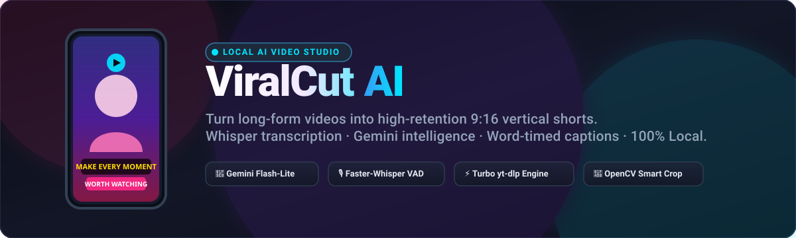
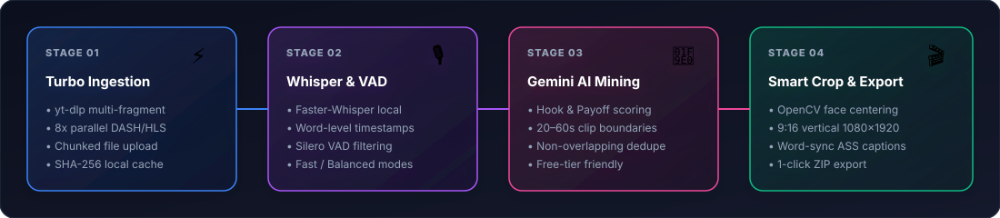
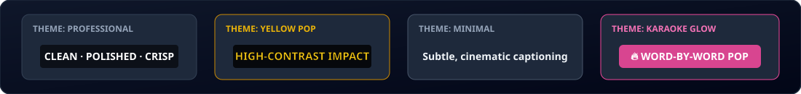

```mermaid
flowchart LR
    A["🎬 Source Video\n(YouTube / Upload)"] --> B["⚡ Turbo Ingestion\n(Parallel yt-dlp)"]
    B --> C["🎙️ Faster-Whisper\n(VAD + Word Timestamps)"]
    C --> D["🧠 Gemini AI Mining\n(Hook & Retention Scoring)"]
    D --> E["📐 OpenCV Face Crop\n(1080×1920 9:16)"]
    E --> F["✨ Dynamic ASS Captions\n(Word-by-word sync)"]
    F --> G["📦 Finished Shorts\n(MP4 + ZIP export)"]

    style A fill:#1e293b,stroke:#3b82f6,stroke-width:2px,color:#fff
    style B fill:#1e293b,stroke:#00e5ff,stroke-width:2px,color:#fff
    style C fill:#1e293b,stroke:#a855f7,stroke-width:2px,color:#fff
    style D fill:#1e293b,stroke:#ec4899,stroke-width:2px,color:#fff
    style E fill:#1e293b,stroke:#eab308,stroke-width:2px,color:#fff
    style F fill:#1e293b,stroke:#10b981,stroke-width:2px,color:#fff
    style G fill:#0f172a,stroke:#ff007f,stroke-width:2px,color:#fff
```

<div align="center">



<br/>

[](https://www.python.org/)
[](https://fastapi.tiangolo.com/)
[](https://aistudio.google.com/)
[](https://github.com/SYSTRAN/faster-whisper)
[](https://ffmpeg.org/)
[](https://github.com/yt-dlp/yt-dlp)
[](https://opencv.org/)
[](https://github.com/)

<h3>✂️ Turn long videos into scroll-stopping, captioned 9:16 vertical shorts — 100% locally.</h3>

<p align="center">
  <b>No Ollama required · Zero cloud video uploads · Real word-synced subtitles · Fast on-device AI</b>
</p>

[Quickstart](#-quickstart-windows) • [Architecture](#-how-it-works) • [Features](#-features) • [Caption Themes](#-caption-themes) • [API](#-api-endpoints) • [Developer Guide](#-developers--tests)

</div>

---

## ⚡ What is ViralCut AI?

**ViralCut AI** is a local, privacy-first video clipping engine. Give it any YouTube link or upload a video, and it automatically:

1. 🚀 **Ingests & downloads** high-speed streams using multi-fragment parallel acceleration.
2. 🎙️ **Transcribes speech** on your local machine using **Faster-Whisper** with word-level timestamps and VAD silence filtering.
3. 🧠 **Analyzes the conversation** using **Google Gemini 3.5 Flash-Lite** to extract high-retention 20–60s highlight moments (scoring hooks, emotion, content payoff, and narrative flow).
4. 🎯 **Tracks faces** with OpenCV and auto-reframes horizontal video into portrait **1080×1920 (9:16)**.
5. ✨ **Burns animated, word-timed ASS captions** in 4 viral styling presets.
6. 💾 **Outputs high-definition H.264/AAC MP4 clips** ready to post to TikTok, YouTube Shorts, and Instagram Reels!

> [!NOTE]
> **No Ollama, heavy local LLM, or GPU cluster required!** Video rendering and Whisper transcription run locally on your CPU/GPU, while semantic transcript highlight detection uses the free Gemini Developer API.

---

## 🔄 How It Works

<div align="center">
  
</div>

<details>
<summary><b>View detailed text pipeline breakdown</b></summary>



</details>

---

## 🌟 Features

| Feature | Description |
| :--- | :--- |
| **⚡ Turbo Video Ingestion** | yt-dlp multi-fragment parallel downloads (default 8 concurrent streams) with `.part` resume support and instant SHA-256 local caching. |
| **🎙️ Local Whisper Speech-to-Text** | Faster-Whisper `BatchedInferencePipeline` with Silero Voice Activity Detection (VAD). Generates ultra-precise word-level timestamps. |
| **🧠 Gemini Highlight Mining** | Weighted AI scoring algorithm evaluating: **Hook (25%)**, **Content (20%)**, **Emotion (15%)**, **Self-Containment (15%)**, **Payoff (10%)**, and **Clarity (10%)**. |
| **🎯 OpenCV Smart Face Crop** | Intelligent multi-frame face detection centers speakers smoothly into a crisp 1080×1920 vertical canvas. |
| **🎨 4 Styled Caption Themes** | Burned-in ASS captions with sub-second synchronization: *Professional*, *Yellow Pop*, *Minimal*, and *Karaoke Glow*. |
| **🔄 Non-Destructive Re-rendering** | Adjust start/end timestamps, swap caption themes, or adjust crop centering in seconds **without re-transcribing** or re-calling AI APIs. |
| **📊 Real Download Progress** | Live, non-faked progress telemetry in the dashboard: `Downloading — 324 MB / 1.2 GB — 27% — 18.4 MB/s — ETA 48s`. |
| **📦 1-Click ZIP Export** | Download individual MP4 clips or package all generated shorts into a single ZIP archive containing `clip_details.json`. |

---

## 🎨 Caption Themes

<div align="center">
  
</div>

Choose from 4 pre-configured caption styles to match your brand:

- 🏛️ **Professional** — Clean, white sans-serif with subtle dark background padding for podcasts and interviews.
- 🟡 **Yellow Pop** — Bold, high-contrast yellow typography optimized for mobile feed retention.
- 🎬 **Minimal** — Elegant, lower-third cinematic captioning without heavy backgrounds.
- 🎤 **Karaoke Glow** — High-energy word-by-word active highlighting with vibrant neon accents.

---

## 🚀 Quickstart (Windows)

### Prerequisites

1. **Python 3.11 or 3.12** on your system `PATH`.
2. **FFmpeg with FFprobe & libass subtitle support**:
   ```powershell
   winget install Gyan.FFmpeg
   ```
   *(Verify by running `ffmpeg -filters | findstr subtitles` in a new terminal)*
3. **Gemini Developer API Key**: Get a free API key from [Google AI Studio](https://aistudio.google.com/apikey).

### 1-Click Launch

1. Clone or download this repository:
   ```bash
   git clone https://github.com/ShounakHub/ViralCut-AI.git
   cd ViralCut-AI
   ```
2. Double-click **`start_windows.bat`**.
   - Automatically initializes the virtual environment (`.venv`).
   - Installs all backend requirements.
   - Launches the local server at **http://127.0.0.1:8000**.
3. Open **http://127.0.0.1:8000** in your browser.
4. Enter your Gemini API key under **Gemini AI settings** and click **Save key** *(stored only on your local machine)*.
5. Paste a video URL or upload an MP4/MOV file, then click **✦ Generate my clips**!

---

## ⚙️ Processing Modes

Customize transcription speed vs. precision before launching a job:

| Mode | Model | Compute Type | Batch Size | Beam Size | Best For |
| :---: | :---: | :---: | :---: | :---: | :--- |
| **FAST** | `base` | INT8 | 8 | 2 | Fast previews, podcasts with clear audio |
| **BALANCED** *(Default)* | `small` | INT8 | 6 | 3 | **Recommended:** Great accuracy & fast CPU speed |
| **HIGH_ACCURACY** | `small` | INT8 | 4 | 5 | Heavy accents, background noise, low-fidelity audio |

---

## 🔌 API Endpoints

ViralCut AI includes a clean, fully documented REST API powered by FastAPI:

| Method | Endpoint | Description |
| :---: | :--- | :--- |
| `GET` | `/api/health` | System health check (FFmpeg, Whisper, Gemini configuration) |
| `POST` | `/api/upload` | Upload local video file (`multipart/form-data`) |
| `POST` | `/api/url` | Submit public video URL (YouTube, Vimeo, Twitch, Dailymotion) |
| `GET` | `/api/jobs` | List recent processing jobs and status |
| `GET` | `/api/jobs/{id}` | Detailed status & live stage telemetry for a job |
| `POST` | `/api/jobs/{id}/cancel` | Gracefully cancel an active download or rendering job |
| `POST` | `/api/jobs/{id}/retry` | Retry a failed, interrupted, or cancelled job |
| `DELETE` | `/api/jobs/{id}` | Permanently delete job, temporary files, and clips |
| `GET` | `/api/jobs/{id}/transcript` | Retrieve word-timestamped transcript JSON |
| `GET` | `/api/jobs/{id}/clips` | Retrieve generated highlight clip manifest |
| `GET` | `/api/jobs/{id}/clips/{clip_id}/video` | Stream vertical MP4 clip preview |
| `GET` | `/api/jobs/{id}/clips/{clip_id}/download`| Download individual MP4 clip |
| `GET` | `/api/jobs/{id}/download-all` | Download all rendered clips as a single ZIP archive |
| `POST` | `/api/jobs/{id}/clips/{clip_id}/rerender` | Edit start/end boundaries, crop, or theme and re-render |

---

## 🛠️ Developers & Tests

Run backend tests and development servers locally:

```powershell
# Set PYTHONPATH and run full test suite
$env:PYTHONPATH="backend"
.venv\Scripts\python.exe -m pytest backend/tests -v

# Run backend development server
.venv\Scripts\python.exe -m uvicorn app.main:app --host 127.0.0.1 --port 8000 --reload
```

Frontend source code is located in `frontend/src` (React/Vite). The pre-built, dependency-free dashboard is served directly from `frontend/dist`.

---

<details>
<summary><b>📌 Limitations & Platform Guidelines</b></summary>

- **Speech-Heavy Content**: Works best on speech-oriented videos (podcasts, interviews, commentary, lectures) of at least 30 seconds.
- **Transcript-First Selection**: Gemini analyzes the spoken transcript to identify engaging hooks. Visual scoring is contextual; no deep face emotion recognition is performed.
- **Local Machine Boundary**: Designed for local personal deployment on `127.0.0.1`. Add user authentication, network isolation, and disk quotas before exposing to public networks.
- **Copyright & Terms**: Only process videos you own or have permission to use. Respect platform terms of service.

</details>

<details>
<summary><b>🔑 Gemini Free-Tier Notes & Quotas</b></summary>

- **No Ollama Required**: Only your free Gemini API key from Google AI Studio is needed.
- **Default Model**: Uses `gemini-3.5-flash-lite`. You can change this by setting the `VIRALCUT_GEMINI_MODEL` environment variable.
- **Local Key Storage**: Your API key is saved locally in `storage/gemini_settings.json` and is never exposed or returned to the browser.
- **Long Video Chunking**: Longer videos are split into overlapping analysis windows. Standard Google AI Studio free-tier RPM/TPM limits apply.

</details>

---

<div align="center">

Made with ❤️ by [Shounak](https://github.com/ShounakHub) · **ViralCut AI**

</div>
